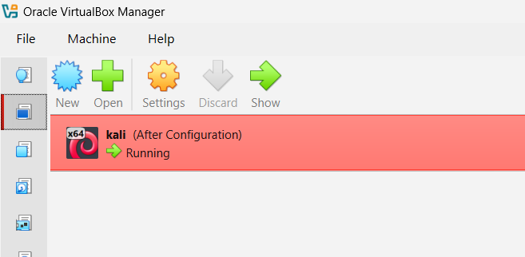
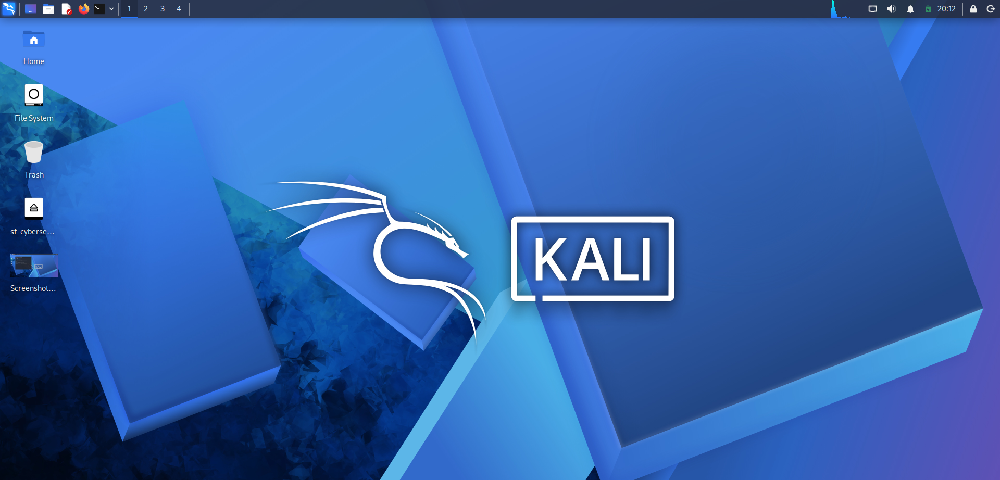
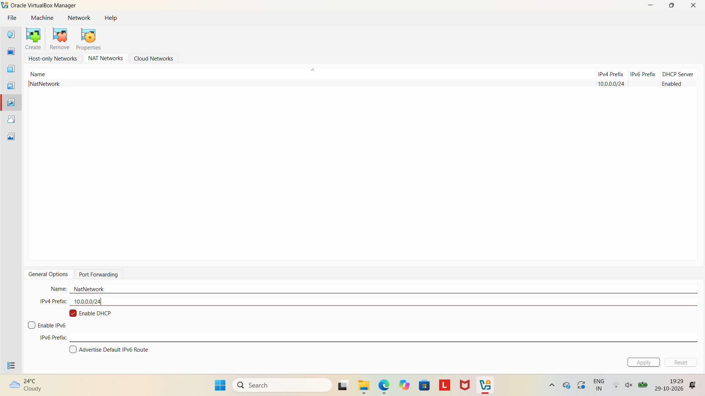
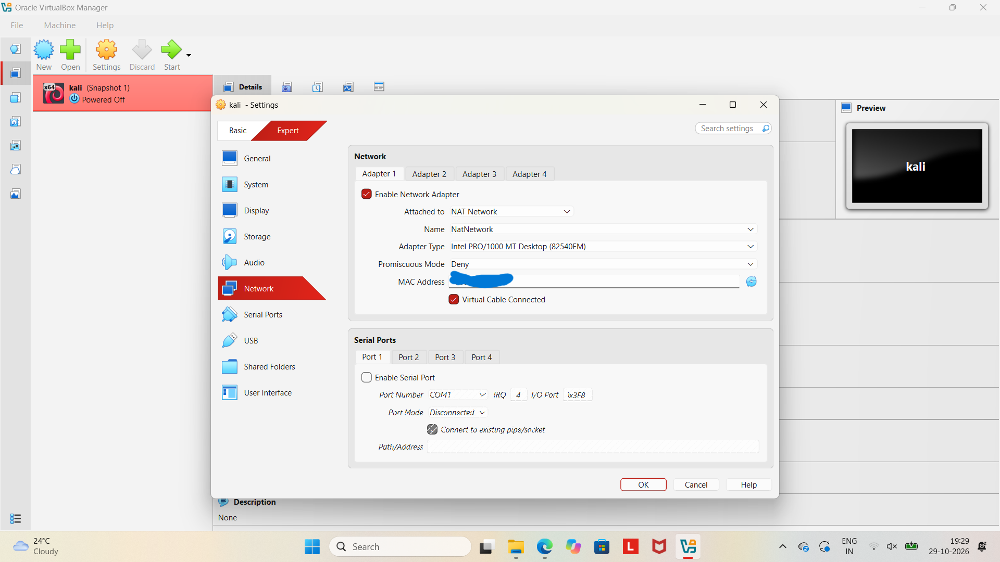
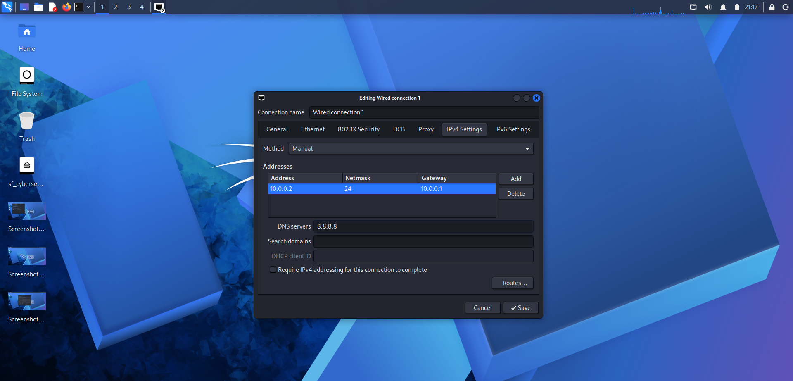
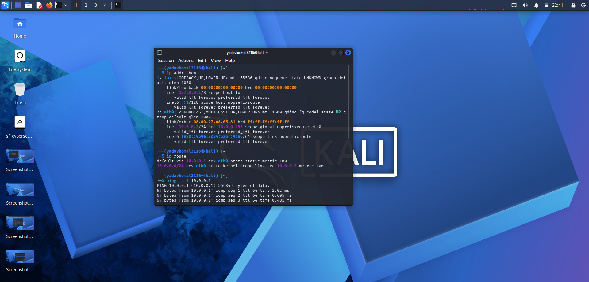
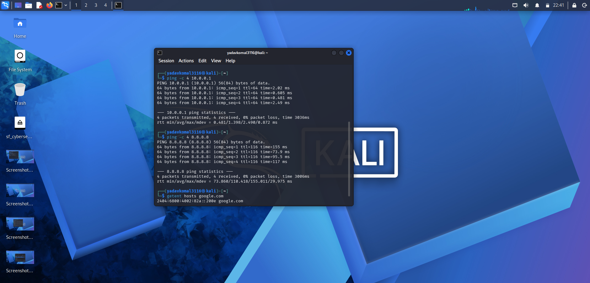
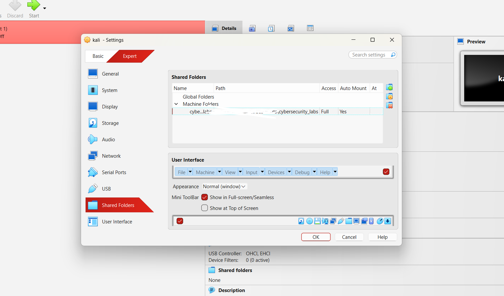
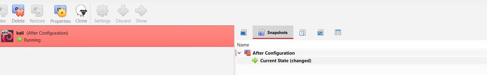

# NETWORKWALKS-Komal-B084-WK1-PM1-CYBERSECURITY-LAB-SETUP


**Cybersecurity Internship — Week 01**

## 📌 Project Overview

This repository documents the setup and configuration of a virtual cybersecurity and penetration-testing laboratory using Oracle VirtualBox and Kali Linux 2026.2.

The primary objective was to establish a controlled virtual environment for cybersecurity learning, network inspection, reconnaissance, vulnerability assessment, and authorized security-testing activities.

The laboratory uses a dedicated VirtualBox NAT Network to provide network connectivity and enable communication between multiple virtual machines connected to the same virtual network.

## 🎯 Objectives

The main objectives of this project were:

- Install and configure Oracle VirtualBox.
- Import and configure Kali Linux 2026.2 as a virtual machine.
- Create and configure a dedicated VirtualBox NAT Network.
- Configure the Kali Linux network adapter.
- Verify IPv4 addressing and network configuration.
- Inspect network interfaces and routing information.
- Perform network connectivity and DNS resolution tests.
- Configure shared folders between Windows and Kali Linux.
- Create a virtual machine snapshot for recovery.
- Document the complete lab setup and verification process.

## 🛡️ Purpose of the Lab

The laboratory provides a controlled environment for learning and practicing cybersecurity concepts.

It can be used for:

- Network reconnaissance
- Port scanning
- Vulnerability assessment
- Network traffic analysis
- Web application security testing
- Penetration-testing practice
- Security-tool experimentation 


## 🏗️ Lab Architecture

The laboratory consists of a host operating system running Oracle VirtualBox, with Kali Linux operating as a guest virtual machine.

The Kali Linux VM is connected to a dedicated NAT Network configured through VirtualBox.

Network Topology

          Windows 11 Host
                 |
          Oracle VirtualBox
                 |
        VirtualBox NAT Network
                 |
            10.0.0.0/24
                 |
           Kali Linux VM
                 |
             10.0.0.2
                 |
        Gateway: 10.0.0.1
                 |
          External Network

The NAT Network allows multiple connected virtual machines to communicate with one another while providing outbound network connectivity through network address translation.

Additional virtual machines can be connected to the same NAT Network in future lab exercises.

## ⚙️ Lab Configuration

| Component | Configuration |
|---|---|
| Host Operating System | Windows 11 |
| Host RAM |8 GB |
| Processor | 11th Gen Intel(R) Core(TM) i5 |
| Hypervisor | Oracle VirtualBox 7.2 |
| Guest Operating System | Kali Linux 2026.2 |
| Allocated VM RAM | 4096 MB |
| Network Mode | NAT Network |
| NAT Network Name | NatNetwork |
| IPv4 Network Prefix | 10.0.0.0/24 |
| DHCP | Enabled |
| Kali Linux IP | 10.0.0.2 |
| Default Gateway |10.0.0.1 |
| DNS Server |8.8.8.8 |
| Shared Folder | Configured |
| VM Snapshot | Created |

## 🪜 Lab Setup Procedure

### Step 1: Installing Oracle VirtualBox

Oracle VirtualBox was installed on the host machine to create and manage virtual machines.

**Activities performed:**

- Installed Oracle VirtualBox.
- Reviewed the virtual machine management interface.
- Prepared the environment for importing Kali Linux.

**Evidence:** 

### Step 2: Importing Kali Linux Virtual Machine

Kali Linux 2026.2 was imported into Oracle VirtualBox as a guest virtual machine.

The virtual machine configuration was reviewed, including memory allocation, processor resources, storage, and network adapter settings.

**Operating System:** Kali Linux 2026.2

**Activities performed:**

- Imported the Kali Linux virtual machine.
- Reviewed the virtual machine settings.
- Started Kali Linux and verified successful booting.

**Evidence:** 

### Step 3: Creating a VirtualBox NAT Network

A dedicated NAT Network was created using VirtualBox Network Manager.

**Network Configuration:**

| Setting | Configuration |
|---|---|
| Network Name | NatNetwork |
| IPv4 Prefix | 10.0.0.0/24 |
| DHCP | Enabled |
| IPv6 |Disabled |

A NAT Network was selected because it allows multiple virtual machines connected to the same network to communicate with each other while providing outbound network connectivity.

**Evidence:** 

### Step 4: Configuring Kali Linux Network Adapter

The Kali Linux virtual machine's network adapter was configured to connect to the newly created NAT Network.

**Adapter Configuration:**

| Setting | Configuration |
|---|---|
| Adapter | Adapter 1 |
| Attached To | NAT Network |
| Network | NatNetwork |
| Adapter Type | Intel PRO/1000 MT Desktop (82540EM) |
| Cable Connected | Enabled |

This configuration establishes the virtual network connection between Kali Linux and the VirtualBox NAT Network.

**Evidence:** 

### Step 5: Kali Linux Network Configuration and Inspection

After starting Kali Linux, the network interface configuration was inspected using Linux networking commands.

**Commands used:**

```bash
ip addr show
ip link show
ip route
```

These commands were used to inspect:

- Available network interfaces.
- Assigned IPv4 addresses.
- Network interface operational status.
- Default gateway and routing information.

**Observed Network Configuration:**

| Parameter | Value |
|---|---|
| IPv4 Address | 10.0.0.2 |
| Network Prefix | 10.0.0.0/24 |
| Subnet Mask | 255.255.255.0 |
| Default Gateway | 10.0.0.1 |
| DNS Server | 8.8.8.8|

**Evidence:** 

### Step 6: Network Connectivity Testing

Network connectivity was tested using standard Linux networking utilities.

**1. Network Interface Inspection**

```bash
ip addr show
```

Purpose: Inspect network interfaces and verify the assigned IP address.

**2. Routing Table Inspection**

```bash
ip route
```

Purpose: Identify the default gateway and routing configuration.

**3. Gateway Connectivity Test**

```bash
ping -c 4 10.0.0.1
```

Purpose: Verify communication with the virtual network gateway.

**4. External Network Connectivity Test**

```bash
ping -c 4 8.8.8.8
```

Purpose: Check outbound connectivity to an external IP address.

**5. DNS Resolution Test**

```bash
getent hosts google.com
```

Purpose: Verify that domain names can be resolved through DNS.

**Verification Summary:**

| Test | Command | Status |
|---|---|---|
| IP Address Inspection | `ip addr show` | Successful |
| Gateway Connectivity | `ping -c 4 10.0.0.1` | Successful |
| External IP Connectivity | `ping -c 4 8.8.8.8` | Successful |
| DNS Resolution | `getent hosts google.com` | Successful |

**Result:** All reported connectivity tests completed successfully.

**Evidence:** 
              

### Step 7: VirtualBox Shared Folder Configuration

A shared folder was configured to enable file exchange between the host operating system and Kali Linux.

**Activities performed:**

- Created a dedicated folder on the host machine.
- Added the folder through VirtualBox Shared Folders settings.
- Configured the shared-folder options.
- Enabled persistent configuration using Make Permanent.
- Auto Mount - Enabled.
- Checked the shared-folder access from Kali Linux.

The shared-folder feature provides a convenient way to transfer scripts, configuration files, and other lab resources between the host and guest operating systems.

**Evidence:** 

### Step 8: Creating a Virtual Machine Snapshot

A virtual machine snapshot was created after completing the initial lab configuration.

**Snapshot Status:** Created *After Configuration*

**Purpose:**

- Provides a recovery point.
- Helps restore the initial lab environment.
- Allows experimentation without losing the baseline configuration.
- Supports safer testing and troubleshooting.

**Evidence:** 

## 🔎 Lab Verification

The following checks were performed to verify the laboratory environment:

- Kali Linux booted successfully.
- Virtual network adapter was connected to NatNetwork.
- Kali Linux received or was configured with IP address 10.0.0.2.
- Network interface and routing information were inspected.
- Gateway connectivity was tested.
- External IP connectivity was tested.
- DNS resolution was tested.
- Shared-folder configuration was completed.
- A virtual machine snapshot was created.

**Overall Result:** The initial virtual cybersecurity lab setup and reported network connectivity tests were completed successfully.


## 💡 What I Learned

Through this project, I gained practical experience with virtualization and Linux networking.

### 1. Virtualization

Learned how to import, configure, and manage virtual machines using Oracle VirtualBox.

### 2. NAT and NAT Network

Understood the difference between standard NAT and NAT Network and how virtual machines communicate through virtual networking.

### 3. Linux Network Inspection

Practiced using commands such as `ip addr`, `ip link`, and `ip route` to inspect network interfaces and routing information.

### 4. IP Addressing and Networking

Developed an understanding of IPv4 addresses, subnet masks, gateways, and DNS configuration.

### 5. Network Troubleshooting

Learned how to diagnose network connectivity issues through gateway testing, external IP connectivity checks, and DNS resolution.

### 6. Shared Folder Configuration

Learned how to establish file sharing between a host operating system and a guest virtual machine and understand the importance of Linux permissions.

### 7. Virtual Machine Snapshots

Understood the importance of creating recovery points before conducting experimental or potentially disruptive security activities.

### 8. Technical Documentation

Gained experience documenting configuration procedures, terminal commands, screenshots, troubleshooting observations, and verification results.


## 🔐 Security Disclaimer

This virtual laboratory is intended for educational purposes and authorized cybersecurity testing.

All scanning, vulnerability assessment, and penetration-testing activities must be performed only within controlled lab environments or on systems for which explicit authorization has been obtained.

---

Made by :
KOMAL
LinkedIn : https://www.linkedin.com/in/komal-7a9928319/
**Project:** Kali Linux Virtual Cybersecurity Lab Setup
**Focus Areas:** Virtualization | Kali Linux | Linux Networking | NAT Networking | Shared Folders | Connectivity Testing
